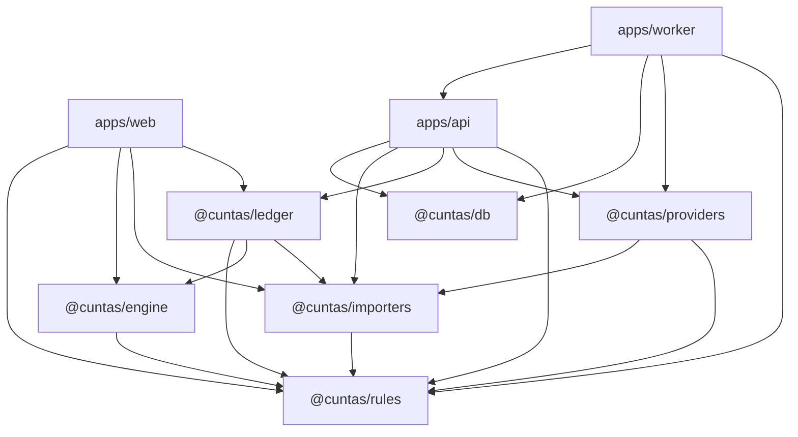
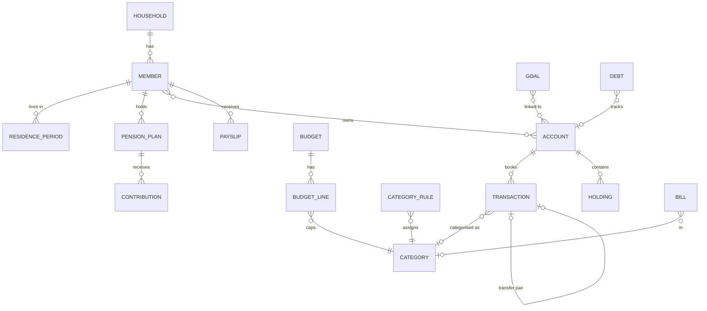
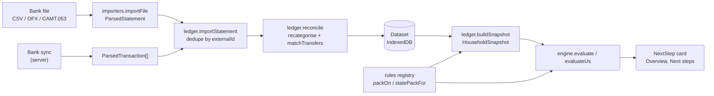
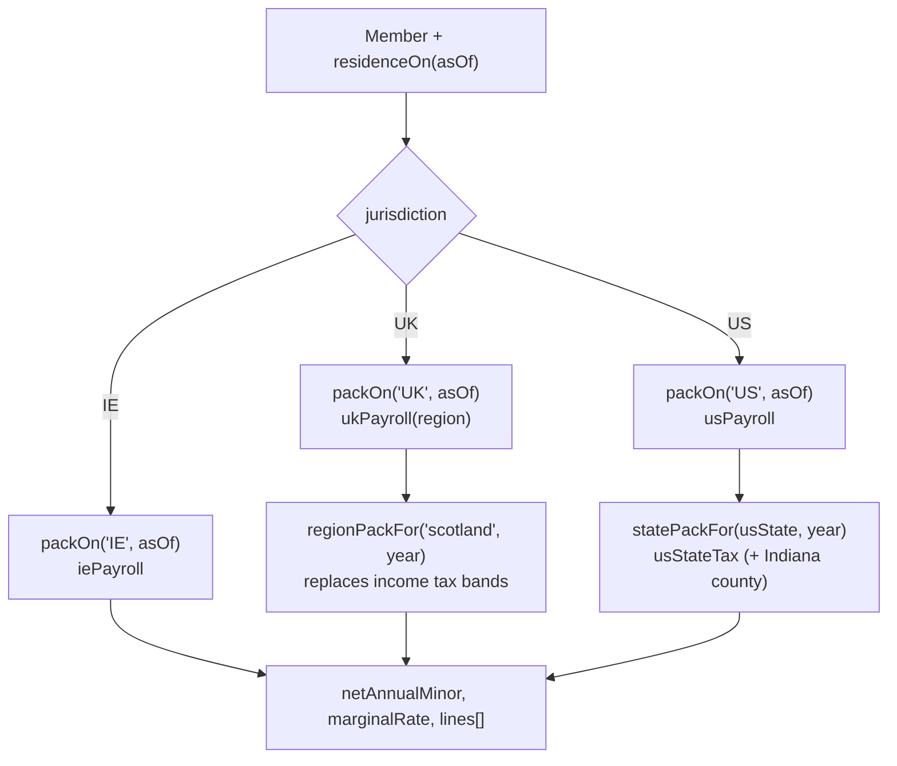
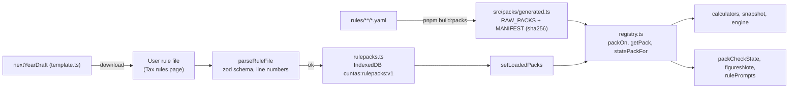
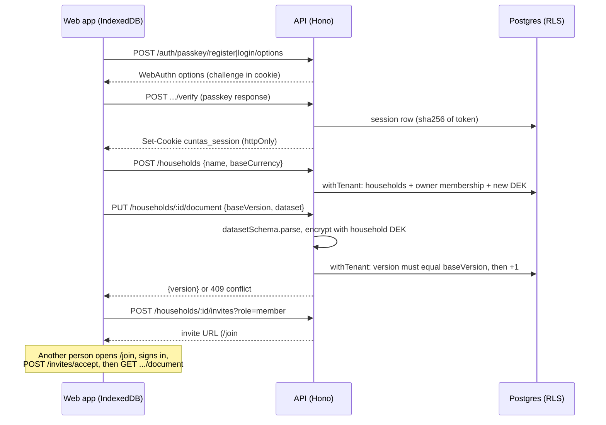
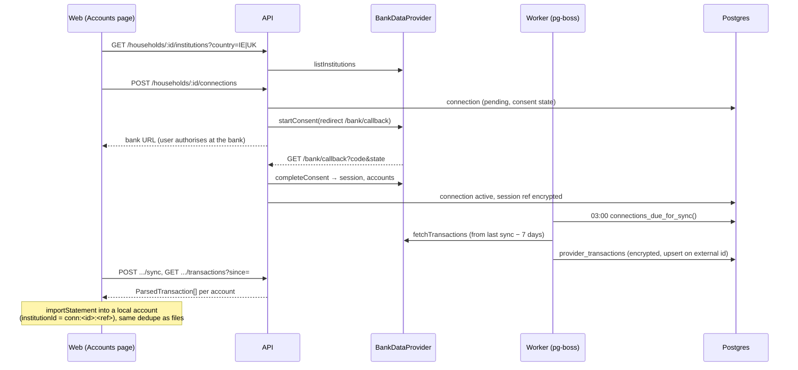

# Cúntas architecture

This document describes the code as it is on 2026-10-25 (branch `master`). It is for a developer who is new to the repo. For rules and acceptance criteria read [SPEC.md](SPEC.md); for build status read [STATUS.md](STATUS.md); for design history read [design/](design/).

Contents:

1. [Overview and principles](#1-overview-and-principles)
2. [Repo map](#2-repo-map)
3. [Data model](#3-data-model)
4. [Key flows](#4-key-flows)
5. [Web app structure](#5-web-app-structure)
6. [Testing and CI](#6-testing-and-ci)
7. [How to extend](#7-how-to-extend)
8. [Glossary](#8-glossary)
9. [Known gaps and inconsistencies](#9-known-gaps-and-inconsistencies)

---

## 1. Overview and principles

Cúntas is a household budgeting and planning app for Ireland, the UK and the US. A household imports bank files (or syncs a bank through a self-hosted server), categorises spending, sets budgets, debts, goals and pensions, and gets one "next step" from a ladder of checks. The Irish ladder follows the r/irishpersonalfinance flowchart; the US ladder follows the r/personalfinance order. Take-home pay and other tax figures come from versioned rule packs: Ireland, the UK (with a Scottish sub-pack), US federal, and all 50 states plus D.C.

The web app is a React PWA. It runs entirely in the browser with data in IndexedDB. A Hono API, a pg-boss worker and Postgres are optional: they add sharing between people, bank sync and server-side FX rates. The same web bundle is wrapped by Capacitor for iOS and Android.

Core principles, and where the code enforces them:

| Principle | What it means in code | Enforced by |
| --- | --- | --- |
| Local-first | Each household is one JSON document in IndexedDB. No server is needed. Server sync is opt-in per household. | [apps/web/src/lib/store.ts](../apps/web/src/lib/store.ts) |
| Money is integer minor units | Every money field is `*Minor: number` (an integer) with a `currency`. Arithmetic uses `applyRate`, `divideMinor`, `splitEvenly`, `toMinor`. Rates are snapped to parts per million. | [packages/rules/src/money.ts](../packages/rules/src/money.ts), `z.number().int()` in the dataset schema |
| No tax figures in code | Tax figures live only in `packages/rules/rules/**/*.yaml`. Calculators read them from a pack. | ESLint `no-magic-numbers` on `packages/rules/src/calculators/**` (allows 0, 1, 100, -1), [eslint.config.js](../eslint.config.js) |
| Versioned, sourced rule packs | Each pack has `version`, `status: provisional | verified`, `effective` dates and `sources`. Each section has its own `source` URL, and may carry its own `status`. | Zod schema in [packages/rules/src/packs/schema.ts](../packages/rules/src/packs/schema.ts); [packages/rules/test/packs.test.ts](../packages/rules/test/packs.test.ts) |
| Explainable output | Calculators return `lines: ExplainedLine[]` with a `RuleRef` (pack version, key, source). Engine cards carry `sources`, `rulePack` and `chart` versions. | [packages/rules/src/packs/types.ts](../packages/rules/src/packs/types.ts), [packages/engine/src/types.ts](../packages/engine/src/types.ts) |
| Guidance, not advice | Engine output names generic steps, never products or providers. Every `EngineResult` carries a `DISCLAIMER`. | [packages/engine/src/engine.ts](../packages/engine/src/engine.ts) |
| Pure core | `rules`, `engine`, `importers` and `ledger` have no I/O. They run the same in Node and the browser. | Package dependencies (below) |

---

## 2. Repo map

pnpm workspace with `apps/*` and `packages/*` ([pnpm-workspace.yaml](../pnpm-workspace.yaml)). Packages are consumed as TypeScript source (`main: src/index.ts`); there is no build step between packages. Node 22 or later.

### Packages

| Package | Responsibility | Key entry files | Depends on |
| --- | --- | --- | --- |
| `@cuntas/rules` | Rule packs (YAML), their zod schema, the registry, money and date helpers, and pure tax calculators (`ie.*`, `uk.*`, `us.*`, `xb.*`) | [src/index.ts](../packages/rules/src/index.ts), [src/money.ts](../packages/rules/src/money.ts), [src/packs/registry.ts](../packages/rules/src/packs/registry.ts), [src/packs/schema.ts](../packages/rules/src/packs/schema.ts), [src/packs/checks.ts](../packages/rules/src/packs/checks.ts), [src/packs/template.ts](../packages/rules/src/packs/template.ts), [scripts/compile-packs.mjs](../packages/rules/scripts/compile-packs.mjs), [rules/](../packages/rules/rules) | `yaml`, `zod` |
| `@cuntas/engine` | Next-step ladder: step definitions and the evaluator | [src/engine.ts](../packages/engine/src/engine.ts), [src/types.ts](../packages/engine/src/types.ts), [src/steps/ie/](../packages/engine/src/steps/ie), [src/steps/us/index.ts](../packages/engine/src/steps/us/index.ts), [src/helpers.ts](../packages/engine/src/helpers.ts) | rules |
| `@cuntas/importers` | Bank file parsing: CSV (presets and column mapper), OFX/QFX, CAMT.053; content-hash ids | [src/index.ts](../packages/importers/src/index.ts), [src/csv.ts](../packages/importers/src/csv.ts), [src/presets.ts](../packages/importers/src/presets.ts), [src/ofx.ts](../packages/importers/src/ofx.ts), [src/camt.ts](../packages/importers/src/camt.ts), [src/hash.ts](../packages/importers/src/hash.ts) | rules, `fast-xml-parser` |
| `@cuntas/ledger` | The `Dataset` schema and everything computed from it: import into the ledger, categorisation, transfers, FX, budgets, waterfall, debts, net worth, goals, bills, retirement, what-if, export, and the snapshot builder | [src/schema.ts](../packages/ledger/src/schema.ts), [src/dataset.ts](../packages/ledger/src/dataset.ts), [src/snapshot.ts](../packages/ledger/src/snapshot.ts), [src/index.ts](../packages/ledger/src/index.ts) | rules, engine (types and thresholds), importers (types), `zod` |
| `@cuntas/providers` | `BankDataProvider` interface; Enable Banking and mock adapters; PSD2 consent dates | [src/types.ts](../packages/providers/src/types.ts), [src/index.ts](../packages/providers/src/index.ts) (`providerFromEnv`), [src/enableBanking.ts](../packages/providers/src/enableBanking.ts), [src/mock.ts](../packages/providers/src/mock.ts) | importers, rules |
| `@cuntas/db` | Drizzle schema, SQL migrations with row-level security, `withTenant`, envelope encryption | [src/schema.ts](../packages/db/src/schema.ts), [src/client.ts](../packages/db/src/client.ts), [src/crypto.ts](../packages/db/src/crypto.ts), [migrations/](../packages/db/migrations) | `drizzle-orm`, `postgres` |

### Apps

| App | Responsibility | Key entry files | Depends on |
| --- | --- | --- | --- |
| `@cuntas/web` | React 18 PWA (Vite, TanStack Router and Query, Tailwind, Recharts). Also the web bundle for the Capacitor iOS and Android shells. | [src/main.tsx](../apps/web/src/main.tsx), [src/router.tsx](../apps/web/src/router.tsx), [src/lib/store.ts](../apps/web/src/lib/store.ts), [src/lib/rulepacks.ts](../apps/web/src/lib/rulepacks.ts), [src/lib/derived.ts](../apps/web/src/lib/derived.ts), [capacitor.config.ts](../apps/web/capacitor.config.ts) | rules, engine, importers, ledger |
| `@cuntas/api` | Hono API with OpenAPI: passkeys and TOTP, households, invites, encrypted document sync, bank connections, FX, admin, signed rule-pack manifest | [src/server.ts](../apps/api/src/server.ts), [src/app.ts](../apps/api/src/app.ts), [src/auth.ts](../apps/api/src/auth.ts), [src/routes/](../apps/api/src/routes), [src/services/](../apps/api/src/services), [src/admin-cli.ts](../apps/api/src/admin-cli.ts) | db, importers, ledger, providers, rules |
| `@cuntas/worker` | pg-boss scheduled jobs: ECB FX refresh, nightly bank sync, reminder queueing | [src/main.ts](../apps/worker/src/main.ts), [src/jobs.ts](../apps/worker/src/jobs.ts) | api (services), db, providers, rules |

### Dependency graph



The web app never imports `db`, `providers`, `api` or `worker`. It reaches the server only through HTTP ([apps/web/src/lib/api.ts](../apps/web/src/lib/api.ts)). The worker imports the API's service layer through the `@cuntas/api/services` export.

### Other top-level files

| Path | What it is |
| --- | --- |
| [docker-compose.yml](../docker-compose.yml) | `postgres`, `migrate` (runs migrations then seed), `api` (port 8787), `worker`, `web` (nginx, port 8080) |
| [Dockerfile](../Dockerfile) | One image for api, worker and migrate; runs TypeScript with `tsx` |
| [apps/web/Dockerfile](../apps/web/Dockerfile), [deploy/nginx.conf](../deploy/nginx.conf) | Static web build served by nginx |
| [deploy/init-roles.sh](../deploy/init-roles.sh) | Creates `cuntas_app` (no login, no RLS bypass) and `cuntas_api` (login, member of `cuntas_app`) |
| [.env.example](../.env.example) | Server configuration (`CUNTAS_KEK`, database passwords, `BANK_PROVIDER`, `RULES_SIGNING_KEY`, origins) |
| [vitest.workspace.ts](../vitest.workspace.ts) | Vitest runs `packages/*`, `apps/api`, `apps/worker` |
| [.github/workflows/ci.yml](../.github/workflows/ci.yml) | CI (section 6) |
| [CHANGELOG.md](../CHANGELOG.md) | One paragraph per change |

---

## 3. Data model

### The Dataset

One `Dataset` holds one household. A device can hold several datasets (one IndexedDB entry each). The server stores the same document, encrypted, as one row per household.

The schema is zod, in [packages/ledger/src/schema.ts](../packages/ledger/src/schema.ts). Types are inferred from it (`Dataset`, `Member`, `Account`, ...). `SCHEMA_VERSION` is `1`. Fields added later use `.default(...)`, so older documents still parse. The same schema validates JSON import ([io.ts](../packages/ledger/src/io.ts)), local reads ([store.ts](../apps/web/src/lib/store.ts)) and server writes ([apps/api/src/services/households.ts](../apps/api/src/services/households.ts)).

| Collection | Entity | Main fields and links |
| --- | --- | --- |
| `household` | The household (single object) | `baseCurrency`; `settings`: payday, fund basis, threshold overrides, owns home, rent, expected mortgage, children |
| `members` | A person | Date of birth, nationality, employment, gross pay, pay frequency, IE assessment, US filing status / state / locality / HSA coverage, UK region, student loans, retirement age, contribution years, self-assessment history |
| `residencePeriods` | Tax residence over time | `memberId` → member; `jurisdiction` (IE, UK, US); `from`/`to` |
| `institutions`, `connections` | Banks and bank-sync consents | Present in the schema; the web app links synced accounts by `institutionId = "conn:<id>:<ref>"` instead |
| `accounts` | Current, savings, card, loan, mortgage, pension, brokerage, property, vehicle, cash | `memberIds` → members; `currency`; `wrapper` (ISA, PRSA, ...); `jurisdiction`; opening balance; `valuations` for manually valued assets; `isEmergencyFund` |
| `transactions` | A booked line | `accountId` → account; `amountMinor` + `currency`; `fxRateToBase`; `externalId` (dedupe key); `categoryId` + `categorySource` (user, rule, dictionary, none); `transferPairId` → the other half of a transfer; `splits` |
| `categories`, `categoryRules` | Categories and user rules | Category has `group`, `isEssential`, `kind`, `waterfall` bucket. Rule matches payee text, regex, amount range or account. |
| `budgets` | One per period (`YYYY-MM`) | `mode`: envelope or cap; `lines` → categories, with rollover |
| `goals` | Emergency fund, house deposit, sinking fund, college, tax set-aside, other | `linkedAccountIds` → accounts, or `savedMinor`; monthly contribution |
| `debts` | Cards, loans, BNPL, PCP, ... | Optional `accountId`; `aprBps`; minimum payment |
| `pensionPlans`, `contributions` | Pensions (IE, UK and US kinds incl. 401(k), IRA, Roth IRA, HSA) and contributions to them | Plan → member; contribution → plan; employee/employer rates and match rule |
| `holdings` | Funds and shares with lots | `accountId` → account; `taxClass` (exit-tax fund, CGT asset, wrapper-exempt) |
| `fxRates` | ECB reference rates | Always `base: "EUR"`; any pair converts through EUR ([fx.ts](../packages/ledger/src/fx.ts)) |
| `stepStates` | Dismissed or recorded engine checks | `stepId`, optional `memberId` |
| `payslips` | Typed-in payslips for checks | → member |
| `bills`, `recurringDismissed` | Confirmed bills and detected payees the user rejected | `payeeKey` links a bill to a detected recurring series |
| `auditEvents` | Local audit trail | Appended by `withAudit` |



Helpers: `createEmptyDataset` and `importStatement` in [dataset.ts](../packages/ledger/src/dataset.ts); `createDemoDataset` in [demo.ts](../packages/ledger/src/demo.ts); `newMember` in [schema.ts](../packages/ledger/src/schema.ts).

### Residence decides the rules

`residenceOn(ds, memberId, date)` in [snapshot.ts](../packages/ledger/src/snapshot.ts) picks a member's jurisdiction from `residencePeriods`, defaulting to `IE`. It decides which payroll calculator runs for that member. `planFor` returns `"US"` only when every member lives in the US; otherwise the Irish ladder runs (also for UK-only and mixed households).

### Server tables

The server does not store the ledger in tables. It stores the whole dataset as one encrypted blob per household. Tables in [packages/db/src/schema.ts](../packages/db/src/schema.ts):

| Table | Holds |
| --- | --- |
| `users`, `passkey_credentials`, `totp_secrets`, `sessions` | Sign-in. Session ids are SHA-256 of the cookie token. |
| `households`, `memberships`, `invites` | Who can open what, with role `owner` or `member`. Each household has its data key (`dek_encrypted`). |
| `household_documents` | `version`, `ciphertext` (the Dataset, AES-256-GCM), `updated_by` |
| `connections`, `provider_transactions` | Bank consents and fetched lines, payloads encrypted |
| `audit_events`, `notifications`, `fx_rates` | Audit trail, queued reminders, ECB rates |

---

## 4. Key flows

### Overview: from import to next step



### 4a. Importing a bank file

1. **Page.** [apps/web/src/pages/Import.tsx](../apps/web/src/pages/Import.tsx) reads the file as text and calls `importFile(name, text)`.
2. **Detect the format.** `detectFileKind` in [importers/src/index.ts](../packages/importers/src/index.ts) checks the first 2,000 characters: CAMT.053 (`BkToCstmrStmt`), OFX (`OFXHEADER`, `<OFX>`, `.ofx`/`.qfx`), else CSV.
3. **Parse.**
   - CSV: [csv.ts](../packages/importers/src/csv.ts). `detectPreset` matches normalised headers against each preset's `signature`; `detectHeaderlessPreset` handles exports with no header row (HSBC UK). With no match, the page shows a column mapper seeded by `guessMapping`, and calls `importFile` again with the mapping. Shared parsing is in [parse.ts](../packages/importers/src/parse.ts): `parseCsv` (RFC 4180, delimiter sniffing), `parseAmount` (to minor units, handles `(12.30)`, `CR/DR`, decimal comma), `parseDate`, `cleanPayee`.
   - OFX: [ofx.ts](../packages/importers/src/ofx.ts). CAMT.053: [camt.ts](../packages/importers/src/camt.ts) with `fast-xml-parser`.
4. **Ids.** Bank ids are used when present. Otherwise `assignContentIds` in [hash.ts](../packages/importers/src/hash.ts) builds `h:<fnv1a64(date|amount|description|n)>`, where `n` counts identical rows in the same file. Two identical coffees on one day both import; the same file imported twice adds nothing.
5. **Into the ledger.** The page calls `importStatement(ds, accountId, statement)` in [ledger/src/dataset.ts](../packages/ledger/src/dataset.ts). It skips lines whose `(accountId, externalId)` already exists, stores amounts in the account's currency, sets `fxRateToBase` from the FX table when the account is not in the base currency, and warns about lines in another currency.
6. **Reconcile.** `reconcile` runs over the whole ledger:
   - `recategorise` ([categories.ts](../packages/ledger/src/categories.ts)): user rules first (highest `priority`), then `MERCHANT_DICTIONARY`. Lines set by the user (`categorySource: "user"`) are never changed. A salary match on an outflow is ignored.
   - `matchTransfers` ([transfers.ts](../packages/ledger/src/transfers.ts)): pairs an outflow with an inflow in another account within 3 days; same currency must match exactly, cross-currency within 3% at the ECB rate.
7. **Save.** The page calls `replaceDataset`; the store writes to IndexedDB after 150 ms. An audit event `import:<n>` is added.

When the user corrects a category on [Transactions](../apps/web/src/pages/Transactions.tsx), `suggestRule` offers a `payeeContains` rule for similar lines.

### 4b. Snapshot, engine and the next step

1. **Hook.** `usePlan(ds)` in [apps/web/src/lib/derived.ts](../apps/web/src/lib/derived.ts) memoises on the dataset, today's date and `rules.revision` (bumped when a rule file loads).
2. **Snapshot.** `buildSnapshot(ds, asOf)` in [ledger/src/snapshot.ts](../packages/ledger/src/snapshot.ts) produces a `HouseholdSnapshot` ([engine/src/types.ts](../packages/engine/src/types.ts)). It contains:
   - `plan` (`"IE"` or `"US"`, from `planFor`) and the base `currency`.
   - Per member (`MemberState`): age, residence, gross and net monthly pay (from `memberPay`, see 4c), marginal rate, pension rates and employer match, MyFutureFund status, and for US members a `us` block (MAGI, workplace plan coverage, IRA and HSA contributions this year).
   - Household figures: liquid savings (accounts marked as emergency fund), 12-month essential spend, tracking counts, the payday waterfall result, debts, sinking funds, housing, children and college goals, dismissals, and the tax set-aside for the self-employed (IE/UK preliminary tax, or US quarterly estimated tax).
   - `thresholds` from the flowchart file (`chartDefaults(plan)`) with the household's `thresholdOverrides` applied (`thresholdsFor`).
3. **Evaluate.** `evaluate(snapshot, iePack)` or `evaluateUs(snapshot, usPack)` in [engine/src/engine.ts](../packages/engine/src/engine.ts). Both call `runLadder`:
   - Steps run in `order`. A step's `scope` is `household` (once) or `member` (once per member).
   - Each step has ordered `checks`. Within a step, the first unmet check blocks later ones from producing a card.
   - Dismissed checks (from `snapshot.dismissed`) are skipped.
   - The first unmet check of the first unmet step becomes `current`. Steps with `alwaysOn` (employer match) produce cards in `alwaysOn` and never become `current`.
   - When nothing is unmet, `options` lists generic choices (pension relief headroom, save or invest, mortgage overpayment).
   - Each card renders `headline` and `explain` templates with `vars`, and carries `sources` (`RuleRef[]`), `progress`, `actions` (links to pages) and the pack and chart versions.
4. **Show.** [components/NextStep.tsx](../apps/web/src/components/NextStep.tsx) renders the card on [Overview](../apps/web/src/pages/Overview.tsx); [Plan](../apps/web/src/pages/Plan.tsx) shows the full ladder. `figuresNote` adds "Figures not checked ..." when the pack in use is unchecked or from an earlier year.

Ladders:

| IE ladder ([steps/ie/](../packages/engine/src/steps/ie)) | US ladder ([steps/us/index.ts](../packages/engine/src/steps/us/index.ts)) |
| --- | --- |
| 0 Track and budget (tracking, budget, waterfall, tax set-aside) | 0 Budget (tracking, budget, essentials, estimated tax) |
| 1 Starter emergency fund | 1 Starter emergency fund |
| 2 Employer match (pension, MyFutureFund, stock), always on | 2 Employer match |
| 3 Debt (high interest, full fund, moderate) | 3 Debt (high interest, full fund) |
| 4 Required purchases (sinking funds) | 4 HSA |
| 5 Retirement (half your age) | 5 IRA |
| 6 Advanced (mortgage-ready, college) | 6 401(k) |
| | 7 Goals |

The IE ladder is also used for UK and mixed households, with the Irish pack; there is no separate UK ladder.

### 4c. Take-home pay through rule packs

`memberPay(ds, member, asOf)` in [snapshot.ts](../packages/ledger/src/snapshot.ts) is the single entry used by the snapshot, the what-if and the household screens. The Tax centre ([pages/Tax.tsx](../apps/web/src/pages/Tax.tsx)) calls the calculators directly with figures the user types.



| Jurisdiction | Calculator | What it covers |
| --- | --- | --- |
| IE | `iePayroll` in [calculators/ie/payroll.ts](../packages/rules/src/calculators/ie/payroll.ts) | Income tax with credits and assessment (single, one parent, married one or two incomes), USC, PRSI computed per pay date (rates change within the year), pension contributions, MyFutureFund |
| UK | `ukPayroll` in [calculators/uk/payroll.ts](../packages/rules/src/calculators/uk/payroll.ts) | Personal allowance taper, rUK or Scottish bands (`ukIncomeTaxBands`), NI, student loans ([studentLoan.ts](../packages/rules/src/calculators/uk/studentLoan.ts)) |
| US | `usPayroll` in [calculators/us/payroll.ts](../packages/rules/src/calculators/us/payroll.ts) | Federal tax for the year by filing status, standard and senior deductions, QBI, child tax credit, Social Security, Medicare, self-employment tax, 401(k) and Section 125 deductions; joint returns share tax by income. When given a state pack, adds state tax. |
| US state | `usStateTax` in [calculators/us/state.ts](../packages/rules/src/calculators/us/state.ts) | Base (federal AGI, federal taxable income or wages), standard deductions (own, federal, phase-outs, step-downs, sliding), exemptions and credits, brackets per filing status, federal tax deductions, renter's deduction, Indiana county rates via `localities` |

Rules every calculator follows:

- It takes a pack as its first argument and an input object in minor units.
- Pack figures are in major units. `toMinor` (re-exported as `ruleMinor`) is the one place they become minor units.
- Rates go through `applyRate`; bands through `bandedTax` in [calculators/shared.ts](../packages/rules/src/calculators/shared.ts).
- It returns explained lines with a `RuleRef` per figure, plus `notes` (for example, "Local income tax isn't included").

Which pack is used: `packOn(jurisdiction, date)` returns the pack whose `effective` range contains the date, or the latest earlier one. `regionPackFor` and `statePackFor` return the sub-pack for the tax year, or the latest earlier one with `exact: false`. A US member with no state set gets federal only.

Namespaced calculators (`ie.payroll`, `uk.isaAllowance`, `us.estimatedTax`, `xb.classify`, ...) are exported from [packages/rules/src/index.ts](../packages/rules/src/index.ts). Cross-border calculators (`xb.classify`, `xb.projectRetirement`, `xb.compareWrappers`) read treaty packs from `rules/xb/` and the projection assumptions in the flowchart files.

### 4d. Rule pack lifecycle



1. **Author.** Packs live in [packages/rules/rules/](../packages/rules/rules). The file path is the registry key: `ie/2027.yaml` → `ie/2027`, `uk/scotland/2026-27.yaml` → `uk/scotland/2026-27`, `us/ca/2026.yaml` → `us/ca/2026`. Non-tax files: `ie/flowchart.yaml` and `us/flowchart.yaml` (ladder thresholds and projection assumptions) and `xb/*.yaml` (treaty references, no figures).
2. **Compile.** `pnpm build:packs` runs [compile-packs.mjs](../packages/rules/scripts/compile-packs.mjs). It parses every YAML file into `RAW_PACKS` and writes a `MANIFEST` of `{ key, version, sha256 }` into [src/packs/generated.ts](../packages/rules/src/packs/generated.ts). This lets Node and the browser load packs the same way, with no file system. `--check` fails when the file is stale; CI and `packs.test.ts` both run that check.
3. **Validate.** The compiler does not validate. Validation is in tests: [rulefiles.test.ts](../packages/rules/test/rulefiles.test.ts) runs every built-in tax pack through `parseRuleFile`; [packs.test.ts](../packages/rules/test/packs.test.ts) checks sources, versions, contiguous effective dates and explicit provisional status.
4. **Registry.** [registry.ts](../packages/rules/src/packs/registry.ts) merges `RAW_PACKS` with any loaded files (a loaded file replaces the built-in with the same key) and caches the result. Lookups: `packOn`, `getPack`, `listPacks`, `regionPackFor`, `statePackFor`, `packByKey`, `previousPack`, `latestWith`, `chartDefaults`, `treatyFor`.
5. **Loaded files.** On the Tax rules page ([pages/TaxRules.tsx](../apps/web/src/pages/TaxRules.tsx)) the user loads a YAML file. `addRuleFile` in [apps/web/src/lib/rulepacks.ts](../apps/web/src/lib/rulepacks.ts) calls `parseRuleFile` ([schema.ts](../packages/rules/src/packs/schema.ts)): YAML errors and schema errors come back with a line number and a dotted path; nothing changes on failure. A passing file is stored with its text and SHA-256 `fingerprint`, registered with `setLoadedPacks`, and `revision` is bumped so results recompute. Files are stored per device, not per household, and are included in the encrypted backup.
6. **Checks.** [checks.ts](../packages/rules/src/packs/checks.ts) defines who checks figures: `CHECK_POLICY` is `maintainer` for IE and UK, `user` for the US. A pack needs a check when it came from a file or its jurisdiction is user-checked. A `PackCheck` records `{ key, fingerprint, checkedAt, sections }`; it only counts for the exact file it was made on. `figuresNote` labels results; `rulePrompts` produces banners (check this year's figures; from 1 November, add next year's US figures).
7. **Next year.** [template.ts](../packages/rules/src/packs/template.ts) builds a draft for the following tax year: last year's figures, dates moved on, dated entries collapsed to the one in force, `status: provisional`, every section marked to check. The user edits it, loads it, and ticks each section.
8. **Server manifest.** `GET /rule-packs/manifest` in [apps/api/src/app.ts](../apps/api/src/app.ts) serves the build `MANIFEST`, signed with Ed25519 when `RULES_SIGNING_KEY` is set. The web app does not consume it today.

### 4e. Optional server sync, sharing and passkey sign-in



- **Client side.** [apps/web/src/lib/server.ts](../apps/web/src/lib/server.ts) holds the operations (`signInToServer`, `openServerHousehold`, `uploadActiveHousehold`, `createOnServer`, `joinWithInvite`, `deleteOnServer`); [lib/api.ts](../apps/web/src/lib/api.ts) is the typed HTTP client with `credentials: "include"`. The server address is `VITE_API_URL` at build time, else `http://localhost:8787`, and can be changed on the Account screen.
- **Sync is manual.** Each local household has `SyncMeta { apiUrl, householdId, version, dirty, lastSyncedAt }`. Any local edit sets `dirty`. "Sync now" on [pages/Account.tsx](../apps/web/src/pages/Account.tsx) PUTs the whole document with `baseVersion`. A 409 shows both choices: keep the server copy or overwrite it. Nothing on the device is replaced without a confirm.
- **Auth.** [apps/api/src/routes/auth.ts](../apps/api/src/routes/auth.ts) uses `@simplewebauthn/server` for passkeys and `otplib` for TOTP. Sessions last 30 days and are bound to a hash of the user agent ([auth.ts](../apps/api/src/auth.ts)). Export and delete need a passkey or TOTP check in the last 5 minutes (`requireRecentAuth`); the web client retries once after a passkey prompt (`withReauth`).
- **Tenancy.** Every query runs inside `withTenant(db, { householdId, userId }, fn)` ([packages/db/src/client.ts](../packages/db/src/client.ts)). It opens a transaction, runs `SET LOCAL ROLE cuntas_app` and sets `app.household_id` and `app.user_id`. RLS policies in [0001_init.sql](../packages/db/migrations/0001_init.sql) restrict each table to that household. Invites are accepted through a `SECURITY DEFINER` function `accept_invite`.
- **Encryption at rest.** [packages/db/src/crypto.ts](../packages/db/src/crypto.ts): each household has a data key (DEK) encrypted under the server's `CUNTAS_KEK`; documents, bank session refs and provider transactions are AES-256-GCM under the DEK. The server can decrypt; this is not end-to-end encryption.
- **Roles.** `owner` can invite, change roles and delete; `member` can read and write the document. A household suspended by an admin is read-only (HTTP 423) but can still be exported and deleted.
- **Admin.** Instance admins ([routes/admin.ts](../apps/api/src/routes/admin.ts), [services/admin.ts](../apps/api/src/services/admin.ts), [0002_admin.sql](../packages/db/migrations/0002_admin.sql)) see household metadata only, never the document. Admin rights are granted only from the shell as the database owner: `pnpm --filter @cuntas/api admin grant <user>`; a trigger blocks the app role from setting `is_admin`.
- **Native apps.** Set `EXTRA_ORIGINS=capacitor://localhost,https://localhost` and `CROSS_SITE_COOKIES=1` (SameSite=None; Secure cookies).

### 4f. Bank connections and the worker



- **Providers.** [packages/providers/src/types.ts](../packages/providers/src/types.ts) defines `BankDataProvider` (read-only AIS). `providerFromEnv` picks `EnableBankingProvider` when `BANK_PROVIDER=enablebanking`, else `MockProvider`. Consent lasts 90 days (`PSD2_CONSENT_DAYS`).
- **Server service.** [apps/api/src/services/bankSync.ts](../apps/api/src/services/bankSync.ts): `startConnection`, `completeConnection`, `syncConnection`, `listProviderTransactions`, `revokeConnection`. Fetched transactions stay on the server, encrypted, until the web app pulls them into its local dataset.
- **Worker.** [apps/worker/src/main.ts](../apps/worker/src/main.ts) schedules three pg-boss jobs (timezone Europe/Dublin), and queues one FX refresh at boot:

| Job | Cron | Does |
| --- | --- | --- |
| `fx-refresh` | 16:30 Mon–Fri | `refreshEcbRates` ([services/fx.ts](../apps/api/src/services/fx.ts)) stores ECB rates in `fx_rates` |
| `bank-sync` | 03:00 daily | `nightlySync` runs `syncConnection` for each active connection; expired consents are marked `expired` |
| `reminders` | 06:00 daily | `queueReminders` inserts `notifications` rows: re-consent 7 days ahead, Form 11, CGT and UK self-assessment deadlines |

Reminders are queued only; nothing delivers them yet (no email or push).

- **FX in the web app.** Settings fetches ECB rates directly from `api.frankfurter.app` ([lib/fx.ts](../apps/web/src/lib/fx.ts)), with or without a server. The API's `GET /fx` serves the same data but the web app does not call it.

---

## 5. Web app structure

### Start-up

[src/main.tsx](../apps/web/src/main.tsx):

1. `initTheme()` and `initNative()` (Android back button inside Capacitor).
2. `loadRulePacks()` registers the user's rule files, then `loadStore()` reads the household index and the active dataset. Rule files load first so every calculation uses them from the first render.
3. With no household: `/join` shows the invite page, anything else shows [Onboarding](../apps/web/src/pages/Onboarding.tsx) (new household, demo, or sign in to a server).
4. Otherwise the TanStack router renders [Layout](../apps/web/src/components/Layout.tsx) and the page.

### Routing

[src/router.tsx](../apps/web/src/router.tsx) is a flat list of code-based routes under one root route. To add a page, add a `[path, Component]` pair. The sidebar groups in `NAV` in [Layout.tsx](../apps/web/src/components/Layout.tsx) match the Guide's sections closely:

| Group | Path | Page | Main logic used |
| --- | --- | --- | --- |
| Money | `/` | [Overview](../apps/web/src/pages/Overview.tsx) | `usePlan`, `netWorthSeries`, `budgetReport`, `xb.classify` |
| | `/plan` | [Plan](../apps/web/src/pages/Plan.tsx) (Next steps) | `usePlan`: ladder, current card, options, dismissals, threshold overrides |
| | `/transactions` | [Transactions](../apps/web/src/pages/Transactions.tsx) | categorise, `suggestRule` |
| | `/budgets` | [Budgets](../apps/web/src/pages/Budgets.tsx) | `budgetReport`, `paydayWaterfall` |
| | `/bills` | [Bills](../apps/web/src/pages/Bills.tsx) | `detectRecurring`, `BILL_TEMPLATES`, `upcomingBills` |
| | `/accounts` | [Accounts](../apps/web/src/pages/Accounts.tsx) | balances, valuations, bank sync (server only) |
| | `/import` | [Import](../apps/web/src/pages/Import.tsx) | flow 4a |
| Plan | `/debts` | [Debts](../apps/web/src/pages/Debts.tsx) | `planPayoff`, `comparePayoff` (avalanche, snowball) |
| | `/goals` | [Goals](../apps/web/src/pages/Goals.tsx) | `goalProgress` |
| | `/pensions` | [Pensions](../apps/web/src/pages/Pensions.tsx) | `pensionReliefHeadroom`, MyFutureFund status, UK annual allowance card |
| | `/retirement` | [Retirement](../apps/web/src/pages/Retirement.tsx) | `retirementPlan` → `xb.projectRetirement` |
| | `/investing` | [Investing](../apps/web/src/pages/Investing.tsx) (Compare wrappers) | `xb.compareWrappers` |
| Tax | `/tax` | [Tax](../apps/web/src/pages/Tax.tsx) (Tax centre) and [pages/tax/](../apps/web/src/pages/tax) | take-home, payslip check, self-assessment, annual allowance, student loans, US planning |
| | `/what-if` | [WhatIf](../apps/web/src/pages/WhatIf.tsx) | `residenceWhatIf` with treaty packs |
| | `/tax-rules` | [TaxRules](../apps/web/src/pages/TaxRules.tsx) | flow 4d |
| Household | `/household` | [Household](../apps/web/src/pages/Household.tsx) | members, residence, US state and county, settings |
| | `/households` | [Households](../apps/web/src/pages/Households.tsx) and [PeopleWithAccess](../apps/web/src/pages/household/PeopleWithAccess.tsx) | add, switch, remove; invites and roles |
| | `/account` | [Account](../apps/web/src/pages/Account.tsx) (Account & sync) | flow 4e |
| | `/settings` | [Settings](../apps/web/src/pages/Settings.tsx) | export JSON/CSV, encrypted backup, FX update, theme, delete all |
| | `/guide` | [Guide](../apps/web/src/pages/Guide.tsx) | static tour |
| | `/admin` | [Admin](../apps/web/src/pages/Admin.tsx) | server admin; nav item shown to admins only |
| (none) | `/join` | [Join](../apps/web/src/pages/Join.tsx) | accept an invite |

Shared UI primitives (`Card`, `PageHeader`, `Button`, `Field`, `MoneyInput`, `Badge`, ...) are in [components/ui.tsx](../apps/web/src/components/ui.tsx). [RulesBanner.tsx](../apps/web/src/components/RulesBanner.tsx) shows rule prompts; [ServerAccess.tsx](../apps/web/src/components/ServerAccess.tsx) is the sign-in card.

### State

There is no Redux or context store. Two small modules expose state with `useSyncExternalStore`:

| Module | Holds | IndexedDB keys |
| --- | --- | --- |
| [lib/store.ts](../apps/web/src/lib/store.ts) | The household index, the active `Dataset`, its `SyncMeta`, the signed-in `ServerAccount` | `cuntas:households:v2` (index and active id), `cuntas:household:<localId>` (one per household), `cuntas:account:v2` |
| [lib/rulepacks.ts](../apps/web/src/lib/rulepacks.ts) | Loaded rule files, checks, dismissed prompts, `revision` | `cuntas:rulepacks:v1` (per device) |

Writes go through `update(fn, auditAction?)` (a pure `Dataset → Dataset` function) or `replaceDataset(ds)`. Saves are debounced by 150 ms; `flush()` runs before switching households. A local household id is separate from the dataset's own id, so two copies of the demo can coexist. TanStack Query is used only for server calls (connections, institutions, admin lists).

### Derived hooks

[lib/derived.ts](../apps/web/src/lib/derived.ts): `usePlan` (snapshot, engine result, figures note), `useBalances` (native and base-currency balances), `useCategoryName`, `useAsOf` (today). Pages compute everything else with `useMemo` over ledger functions.

### Region and wording

[lib/region.ts](../apps/web/src/lib/region.ts): `homeOf(ds)` is the members' shared residence (US when the US ladder applies; IE for mixed households; the base currency's country before anyone is added). `termsFor(ds)` returns US wording ("Checking account", "401(k) and IRAs", `en-US` dates) or Irish/UK wording (`en-IE`). `setDisplayLocale` in [lib/format.ts](../apps/web/src/lib/format.ts) applies the date style. Theme is in [lib/theme.ts](../apps/web/src/lib/theme.ts).

### The native (Capacitor) build

`pnpm --filter @cuntas/web build:native` runs `tsc`, then `CAPACITOR=1 vite build`, then `cap sync`. The differences from the PWA:

- [vite.config.ts](../apps/web/vite.config.ts) leaves out `vite-plugin-pwa` (no service worker), because the app serves files from its bundle.
- [capacitor.config.ts](../apps/web/capacitor.config.ts): `appId: ie.cuntas.app`, `webDir: dist`, Android scheme `https`.
- [lib/native.ts](../apps/web/src/lib/native.ts) is the only native code: `isNative` and the Android back button.
- `apps/web/ios` and `apps/web/android` are generated projects (ignored by ESLint).

Storage, files, app lock, notifications and store submission for the native apps are planned in [design/mobile-apps.md](design/mobile-apps.md).

---

## 6. Testing and CI

| Layer | Tool | Where | Notes |
| --- | --- | --- | --- |
| Rules calculators | Vitest | [packages/rules/test/](../packages/rules/test) | Golden files: [golden.test.ts](../packages/rules/test/golden.test.ts) (IE/UK cases from the spec), [golden-us.test.ts](../packages/rules/test/golden-us.test.ts), [golden-us-limits.test.ts](../packages/rules/test/golden-us-limits.test.ts), [golden-us-states.test.ts](../packages/rules/test/golden-us-states.test.ts). Expected values come from official worked examples or hand calculation and are **never edited to make a test pass**. Plus `calculators`, `packs`, `rulefiles`, `usstate`, `phase4`. |
| Engine | Vitest | [packages/engine/test/](../packages/engine/test) | Snapshot fixtures in `fixtures.ts`; IE and US ladders |
| Importers | Vitest | [packages/importers/test/](../packages/importers/test) | Real-layout fixtures in `fixtures/` |
| Ledger | Vitest | [packages/ledger/test/](../packages/ledger/test) | Import, transfers, budgets, snapshot, US snapshot |
| DB | Vitest + PGlite | [packages/db/test/](../packages/db/test) | `rls.test.ts` runs the real migrations in in-process Postgres and checks tenants can't see each other |
| API, worker | Vitest + PGlite | [apps/api/test/](../apps/api/test), [apps/worker/test/](../apps/worker/test) | Full Hono app against PGlite, mock provider |
| Web | Playwright | [apps/web/e2e/](../apps/web/e2e) | Two projects: `desktop` (Desktop Chrome) and `mobile` (Pixel 7). Starts Vite on port 5174. `screens.spec.ts` runs only with `SHOTS_DIR` set. |

There are no unit tests for `apps/web/src`; it is covered by Playwright. Working agreement: test-first for `packages/rules` and `packages/engine`.

On 2026-10-25: 399 Vitest tests and 26 Playwright tests (13 tests × 2 projects, 2 skipped) pass.

Commands (use `npx -y pnpm@9.15.0 <cmd>` if pnpm is not installed):

```sh
pnpm install
pnpm test            # Vitest, all packages + api + worker
pnpm lint            # ESLint, including the calculator literal rule
pnpm typecheck       # tsc in every package
pnpm build:packs     # regenerate generated.ts after editing YAML
pnpm test:e2e        # Playwright, desktop and mobile
pnpm dev             # web app on :5173, no server
docker compose up    # web :8080, api :8787, worker, Postgres
```

CI ([.github/workflows/ci.yml](../.github/workflows/ci.yml)) runs on every push and pull request:

- `test` job: install (frozen lockfile), `compile-packs.mjs --check`, lint, typecheck, Vitest, Playwright (Chromium). Uploads the Playwright report on failure.
- `audit` job: `pnpm audit --prod --audit-level high` and a Trivy file-system scan (HIGH, CRITICAL).

---

## 7. How to extend

Each change also needs a `CHANGELOG.md` paragraph, and `docs/SPEC.md` updated if a decision changes.

### Add a tax year to an existing jurisdiction

1. Copy the previous year's YAML (for example `rules/uk/2027-28.yaml` → `rules/uk/2028-29.yaml`), or download the draft from the Tax rules page (`nextYearDraft`).
2. Update `taxYear`, `version`, `effective`, `sources`, and every figure. Keep a `source` on every section. Use `status: provisional` until confirmed; inside a verified pack, mark unconfirmed sections `status: provisional`.
3. Run `pnpm build:packs`.
4. Write golden tests first, from official examples where they exist, in the relevant `golden*.test.ts`.
5. `pnpm test`. `rulefiles.test.ts` validates the new pack against the schema; `packs.test.ts` checks that effective dates are contiguous.

If the new year adds a new kind of figure, extend the TypeScript type in [types.ts](../packages/rules/src/packs/types.ts) and the zod schema in [schema.ts](../packages/rules/src/packs/schema.ts) together (the schema is `.strict()`, so unknown keys fail), then the calculator. Calculators may not contain numeric literals other than 0, 1, 100 and -1.

### Add or change a US state

1. Create `rules/us/<code>/2026.yaml` with `kind: usState`, `state`, `parent: US`, `taxYear`, `version` (`US-<CODE>-2026.1`), `status: provisional`, `effective`, `sources`, and an `incomeTax` section with its `source`. Look at a state of similar shape: a flat rate (`il`, `in`), brackets (`ca`, `ny`), no wage tax (`tx`), local rates (`in`).
2. If the state needs a rule `usStateTax` does not model, add an optional field to `UsStatePack` in [types.ts](../packages/rules/src/packs/types.ts) and to the `usStatePack` schema, then handle it in [calculators/us/state.ts](../packages/rules/src/calculators/us/state.ts).
3. `pnpm build:packs`, then golden tests in [golden-us-states.test.ts](../packages/rules/test/golden-us-states.test.ts) that reproduce a published example where one exists, and say so when worked by hand.
4. The state already appears in the UI: `US_STATES` in [usStates.ts](../packages/rules/src/usStates.ts) lists all 51 codes, and the Household page, Tax centre and Tax rules page pick packs from the registry.

### Add a CSV bank preset

1. Add a `CsvPreset` to `PRESETS` in [presets.ts](../packages/importers/src/presets.ts): `id`, `name`, `country`, `signature` (normalised headers that must all be present), the column mapping, `dateFormat`, `defaultCurrency`, and any of `fee`, `debit`/`credit`, `where`, `detailRows`, `invertAmount`, `signFrom`, `skip`, `headerless` that the layout needs.
2. Add an anonymised sample file to [packages/importers/fixtures/](../packages/importers/fixtures) and a test in [importers.test.ts](../packages/importers/test/importers.test.ts): it detects the preset, parses amounts and dates, and re-import is idempotent.
3. Check the signature against existing presets: `detectPreset` picks the matching preset with the longest signature, so a shorter overlapping signature loses.

### Add an engine step or check

1. Write the test first in [engine.test.ts](../packages/engine/test/engine.test.ts) or [us.test.ts](../packages/engine/test/us.test.ts), using fixtures in `fixtures.ts`.
2. For the IE ladder, add a file in [src/steps/ie/](../packages/engine/src/steps/ie) exporting a `StepDefinition` (`id`, `order`, `title`, `chartRule`, `jurisdictions`, `scope`, `checks`) and add it to `IE_STEPS` in [steps/ie/index.ts](../packages/engine/src/steps/ie/index.ts). For the US ladder, add it to [steps/us/index.ts](../packages/engine/src/steps/us/index.ts).
3. Each check needs `isMet`, `progress`, `headline`/`explain` templates with `{var}` placeholders, `vars`, `sources` (`RuleRef`s to the pack or chart), and `actions` (links to pages). Thresholds belong in `rules/<ie|us>/flowchart.yaml`, not in code.
4. If the check needs data the snapshot doesn't have, add a field to `HouseholdSnapshot` or `MemberState` in [types.ts](../packages/engine/src/types.ts) and fill it in `buildSnapshot` ([snapshot.ts](../packages/ledger/src/snapshot.ts)), with a ledger test.
5. No product or provider names in any text.

### Add a page

1. Create `apps/web/src/pages/<Name>.tsx` exporting a component. Read the dataset with `useDataset()`, write with `update(ds => ...)`, and use `PageHeader` and `Card` from [ui.tsx](../apps/web/src/components/ui.tsx).
2. Put calculations in a package (usually `ledger` or `rules`), with Vitest tests, not in the page.
3. Add the route to `pages` in [router.tsx](../apps/web/src/router.tsx), the nav item to `NAV` in [Layout.tsx](../apps/web/src/components/Layout.tsx), and a topic in [Guide.tsx](../apps/web/src/pages/Guide.tsx).
4. Use `termsFor(ds)` for wording that differs between US and IE/UK households.
5. Add or extend a Playwright spec in [apps/web/e2e/](../apps/web/e2e); it runs on desktop and mobile.

### Add a dataset field

Add it to the zod schema in [schema.ts](../packages/ledger/src/schema.ts) with a `.default(...)` so stored and synced documents still parse. Update `createEmptyDataset` and the demo if needed. The server stores the document as a blob, so no SQL migration is needed for dataset fields. A SQL migration (`packages/db/migrations/000N_*.sql`) is needed only for server tables.

---

## 8. Glossary

| Term | Meaning |
| --- | --- |
| Rule pack (pack) | A YAML file of tax figures for one jurisdiction and tax year (`ie/2027`, `uk/2026-27`, `us/2026`). Typed as `IePack`, `UkPack`, `UsPack`. |
| Sub-pack | A regional pack that sits under a national one: `UkRegionPack` (Scotland replaces UK income tax bands) or `UsStatePack` (a state's income tax). Has `kind` and `parent`. |
| Pack key | The registry key, the YAML path without `.yaml`. Built-in and loaded packs share keys; a loaded file replaces the built-in. |
| Section | A top-level object in a pack with its own `source` (for example `usc`, `incomeTax`). Checks tick sections. |
| Provisional / verified | Pack status. Provisional means not yet confirmed against official sources (for example a Budget not yet law). A section can be provisional inside a verified pack. |
| Rule file | A pack the user loads on a device from the Tax rules page. Validated by `parseRuleFile` and stored per device. |
| Fingerprint | SHA-256 of a pack's YAML text. In `MANIFEST` for built-ins; computed on load for rule files. A check is tied to a fingerprint. |
| Check / you-check model | The user confirming each section of a pack against its source. US packs are user-checked (`CHECK_POLICY.US.checkedBy = "user"`); IE and UK packs are maintainer-checked. |
| Flowchart / chart defaults | `rules/ie/flowchart.yaml` and `rules/us/flowchart.yaml`: ladder thresholds and projection assumptions (`ChartDefaults`). |
| Treaty pack | `rules/xb/*.yaml`: references to treaty articles and moving notes, no figures. |
| Ladder | The ordered list of steps the engine evaluates: IE (r/irishpersonalfinance) or US (r/personalfinance). |
| Step / check | A step is a rung of the ladder; it holds ordered checks. The first unmet check of the first unmet step is the next step. |
| Always-on step | A step whose unmet checks always show as cards but never block the ladder (employer match). |
| Snapshot | `HouseholdSnapshot`: the figures the engine needs, built from a dataset on a date by `buildSnapshot`. The engine sees only the snapshot, pack and chart. |
| Next step / card | `NextStepCard`: the headline, why, progress, sources and actions for one unmet check. |
| Options | Generic choices shown when every step is met. |
| Minor units | Integer cents or pence. All money in code; packs hold major units and convert with `toMinor`. |
| Base currency | The household's reporting currency. Other currencies convert through EUR with ECB rates. |
| Payday waterfall | Allocation of pay into buckets in order (housing, food, essential bills, ...) to find the first short bucket. |
| `xb` | Cross-border: calculators and packs that involve more than one country. |
| Dataset / household document | The whole of one household's data, as validated by `datasetSchema`; the unit of storage and sync. |
| DEK / KEK | Per-household data key / server key-encryption key (`CUNTAS_KEK`) for encryption at rest. |
| RLS / `withTenant` | Postgres row-level security, and the helper that scopes a transaction to one household. |

---

## 9. Known gaps and inconsistencies

Found while writing this document. None of these were changed.

- **Bank sync is IE/UK only.** The API's institution and connection routes accept `country: "IE" | "UK"`, and the Accounts page offers only those. When pulling synced accounts, [Accounts.tsx](../apps/web/src/pages/Accounts.tsx) sets a new account's currency to GBP or else EUR, so a USD account would be created as EUR.
- **Reminders.** `queueReminders` only queues for households that have an active bank connection, and only IE and UK deadlines. Nothing delivers them.
- **TOTP has no UI.** The API has `/auth/totp/*`, but the web client only uses passkeys.
- **FX source.** The web app fetches rates from `api.frankfurter.app` even when a server is connected; the API's `/fx` is unused by the client.
- **Signed manifest is unused.** `/rule-packs/manifest` is served but nothing in the web app reads it.
- **Flowchart files can't be loaded.** `chartDefaults` and treaty packs read `RAW_PACKS` directly, so a loaded rule file can't replace them, and `parseRuleFile` rejects them.
- **The compiler doesn't validate.** `compile-packs.mjs` only parses YAML; schema validation of built-in packs happens in `rulefiles.test.ts`.
- **UK households use the Irish ladder and pack.** `usePlan` and `evaluate` pass the IE pack for any non-US household, so ladder text (for example DIRT in the starter-fund explanation) is Irish for a UK-only household.
- **Stale comments and docs:**
  - `TAX_JURISDICTIONS` in [packs/types.ts](../packages/rules/src/packs/types.ts) says "US packs are federal only; states come later".
  - The `usPayroll` doc comment says state tax is not included; it is when a state pack is passed.
  - `matchTransfers` says "EUR-GBP pairs"; it handles any currency pair.
  - CLAUDE.md says calculators may use 0, 1 and 100; ESLint also allows -1.
  - CLAUDE.md says "one file per step in `src/steps/ie/`"; the US ladder is one file, [steps/us/index.ts](../packages/engine/src/steps/us/index.ts).
  - CLAUDE.md names only `golden.test.ts`; there are four golden files.
  - [README.md](../README.md) still describes the app as Ireland and UK, lists only IE/UK presets, and says members are managed under "Household → People with access" (it is on the Households page).
  - The PWA manifest description in [vite.config.ts](../apps/web/vite.config.ts) says "Irish and UK tax rules".
  - [design/mobile-apps.md](design/mobile-apps.md) lists TOTP under the web client's server sign-in; the web client has none.
- **Chart text in code.** The IE starter-fund step's `chartRule` string says "EUR 1,500", which duplicates `starterFund.floor` in `ie/flowchart.yaml`. It is descriptive text, not a calculation, but it can drift.
- **Unused schema collections.** `institutions` and `connections` in the dataset schema are not filled by the web app; synced accounts are linked through `institutionId = "conn:<id>:<ref>"`.
